<div align="center">


<br><br>


<br>

<a href="#dns-resolver"></a>&nbsp;
<a href="#http-server"></a>&nbsp;
<a href="#try-it-yourself"></a>&nbsp;
<a href="#contact"></a>

</div>

<br>

Hi, I'm Or, a computational biology student at Bar-Ilan University. I took Computer Networks as an elective and got hooked. The course went through the five-layer TCP/IP model in depth: HTTP, DNS and SMTP on the application layer, TCP and UDP on the transport layer, IP and routing protocols such as OSPF and BGP on the network layer, Ethernet and ARP on the link layer, and down to the physical layer, where it all becomes bits on a wire.

This repository holds a project I built around two of the central protocols, DNS and HTTP. Both parts began as course assignments, and I later reworked them into standalone tools written directly on sockets, in Python.

<picture>
  <source media="(prefers-color-scheme: dark)" srcset="assets/layers-dark.svg">
  
</picture>

<br>

## dns-resolver

I built name resolution on the same principle as DNS, split across three programs. An authoritative server answers from its zone file, a client asks the questions, and between them sits a resolver that walks the hierarchy: it asks the parent server, follows NS referrals to the server that owns the zone, and caches both the answers and the referrals for a set TTL. With the cache in place, a repeated lookup within the TTL is answered locally, and a question about a known zone skips the parent and goes straight to that zone's server.

<br>

## http-server

I wrote an HTTP/1.1 web server and client on top of TCP sockets and handled the protocol by hand: the server parses every request itself and builds each response down to the status line and headers. Connections are served by a pool of worker threads. The need for it became clear in Chrome, which opened a spare connection and left it idle: with a single worker, the next request had nowhere to go.

<br>

## Try it yourself

You're welcome to run both parts and watch them work. Each folder has an `examples/` directory with a demo script that starts the servers it needs on localhost, walks through a series of requests, prints what happens at every step and shuts everything down at the end. The output of a full run is saved next to it, so you can compare your run with mine.

```
dns-resolver/
  authoritative_server.py, resolver.py, client.py
  zones/                   zone files for the two authoritative servers
  examples/
    run_demo.py            starts two servers and a resolver, sends six lookups
    demo_output.txt        saved output of a full run
http-server/
  http_server.py, http_client.py
  files/                   the folder the server serves
  examples/
    run_demo.py            starts the server and sends a series of requests
    demo_output.txt        saved output of a full run
```

The demos need Python 3 and nothing else. From the repository root:

```
cd dns-resolver
python examples/run_demo.py
```

```
cd http-server
python examples/run_demo.py
```

<br>

## Contact

If you're hiring for a networking or software role, I'd be glad to hear from you.

<a href="mailto:or.brener.2015@gmail.com"></a>&nbsp;
<a href="https://www.linkedin.com/in/or-brener2026"></a>
