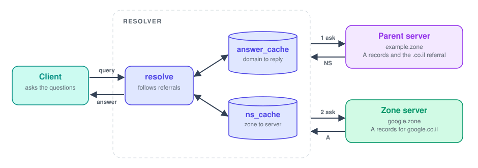

<div align="center">


<br><br>


<br>

<a href="#protocol"></a>&nbsp;
<a href="#key-parts"></a>&nbsp;
<a href="#decisions"></a>&nbsp;
<a href="#running-it"></a>

</div>

<br>

## Summary

A small DNS built from three programs over UDP: an authoritative server that answers from a zone file, a caching resolver that follows NS referrals from zone to zone, and an interactive client. The wire format is plain text, one line per message.

<picture>
  <source media="(prefers-color-scheme: dark)" srcset="assets/facts-dark.svg">
  
</picture>

<br>

## How a lookup works

<picture>
  <source media="(prefers-color-scheme: dark)" srcset="assets/flow-dark.svg">
  
</picture>

<br>

## Protocol

- Query: a single domain name
- Reply: `domain,ip[:port],TYPE`, or `non-existent domain`
- `A` answers a name with an address, `NS` delegates a zone to another server
- Zone file: one record per line, `domain,ip[:port],TYPE`

<br>

## Key parts

- `Record`: named tuple of domain, value and type, with the wire format in `__str__`
- `load_zone`: parses a zone file and skips malformed lines with a warning
- `find_answer`: exact `A` match first, otherwise the longest matching `NS` suffix
- `Resolver`: holds the two caches and the referral-following loop
- `answer_cache`: domain to reply and expiry time
- `ns_cache`: zone suffix to server address and expiry time
- `resolve`: serves from cache, starts at the closest cached zone, follows referrals
- `_closest_ns`: picks the most specific cached zone that contains the domain
- Client: `lookup` sends a query and `show` prints the address

<br>

## Decisions

- Referrals are cached per zone: once `.co.il` is known, other names under it skip the parent server
- NS records get a leading dot, so `co.il` cannot match `xco.il`
- Referral chains are capped at 10 hops, so two servers that point at each other end in `non-existent domain` instead of a loop
- A fresh UDP socket per upstream query, closed after use, with a 5 second timeout
- An unreachable server is reported as `non-existent domain`, because the protocol has no error reply

<br>

## Limits

- One TTL for every record, set at startup, where real DNS carries a TTL per record
- Plain text over UDP, no recursion flags, record types A and NS only

<br>

## Running it

```
python authoritative_server.py 55555 zones/example.zone
python resolver.py 12345 127.0.0.1 55555 --ttl 60
python client.py 127.0.0.1 12345
```

`examples/run_demo.py` starts two zone servers and a resolver and sends six lookups. Its output is saved in `examples/demo_output.txt`.
