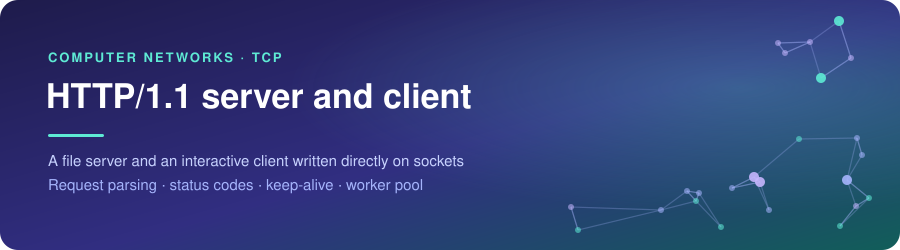
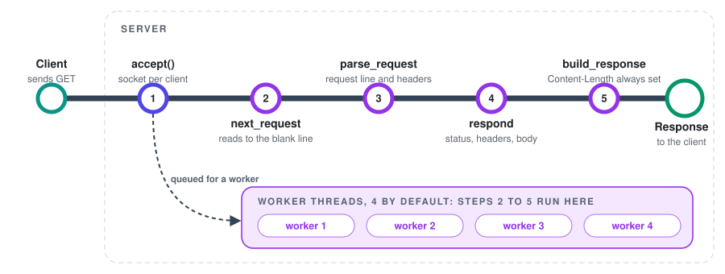

<div align="center">



<br><br>


<br>

<a href="#behavior"></a>&nbsp;
<a href="#key-parts"></a>&nbsp;
<a href="#decisions"></a>&nbsp;
<a href="#running-it"></a>

</div>

<br>

## Summary

An HTTP/1.1 file server and client written directly on TCP sockets, with a worker pool for concurrent connections. Both ends of the protocol are implemented by hand, from request parsing to response framing.

<picture>
  <source media="(prefers-color-scheme: dark)" srcset="assets/facts-dark.svg">
  
</picture>

<br>

## How a request is handled

<picture>
  <source media="(prefers-color-scheme: dark)" srcset="assets/flow-dark.svg">
  
</picture>

<br>

## Behavior

- GET only, with 200, 301, 400, 404 and 405 (with `Allow: GET`)
- `Content-Type` is chosen by file extension
- Query strings are ignored and `%XX` escapes are decoded
- Keep-alive on request, `Connection: close` in any capitalization, one-second idle timeout

<br>

## Key parts

- `next_request`: reads from the socket until the blank line that ends the headers, and returns any leftover bytes so the next request is not lost
- `parse_request`: turns the request line and headers into a `Request` named tuple
- `respond`: maps a request to a status code and decides whether the connection stays open
- `build_response`: assembles the status line and headers, and always sets `Content-Length`
- `safe_path`: resolves the requested path against the served folder and rejects anything outside it
- `handle_connection`: serves requests on one socket until it closes or times out
- `serve`: accepts connections and hands each one to a `ThreadPoolExecutor`
- Client: `fetch` reuses one connection and reconnects once if the server closed it

<br>

## Decisions

- Worker pool of 4 (`--workers`) instead of one connection at a time: in Chrome 153, a spare idle connection kept a single worker busy and a request waited until Chrome cancelled it. With four workers every request was answered (one observation per setup)
- Paths resolved with `realpath` and checked against the root, which closes `/../` and `/%2e%2e/` traversal
- A malformed request line gets 400 and the server keeps running
- `--verbose` logs a connection when it is accepted, so queued connections show up

<br>

## Limits

- Static files only, no HTTPS
- Keep-alive is opt-in, unlike the HTTP/1.1 default

<br>

## Running it

```
python http_server.py 8080
python http_client.py 127.0.0.1 8080
```

Options: `--root`, `--workers`, `--verbose` for the server, `--output-dir` for the client. `examples/run_demo.py` runs seven cases and its output is saved in `examples/demo_output.txt`.
